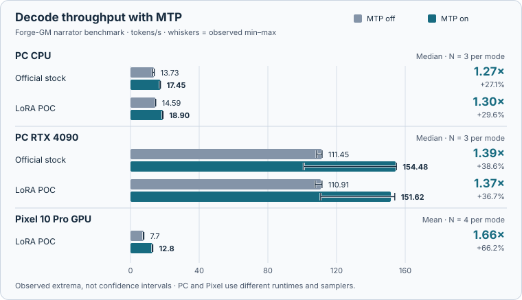

# Forge-E4B-p

**Fixed-scale LoRA adaptation of Gemma 4 E4B mobile QAT → mixed-bit LiteRT-LM with MTP**

A reproducible proof of concept for adapting Google's Gemma 4 E4B mobile-QAT checkpoint without discarding its original mixed INT2/INT4/INT8 representation or the official multi-token prediction (MTP) drafter.

[Workflow](#workflow) · [Validation](#validation) · [Benchmarks](#mtp-performance) · [Reproduce](#reproduce-it) · [Repository layout](#repository-layout)

---

| **3.49 GB** | **INT2 / INT4 / INT8** | **1.37×** |
| :---: | :---: | :---: |
| Repacked model | Original mixed precision | GPU median decode speedup with MTP |

> **Scope:** A clean-checkout, one-update synthetic proof of concept. This demonstrates packaging correctness and CPU/GPU inference, not model quality or generalization.

## Workflow

The adaptation retains the original quantization grid. Only audited packed weight payloads in the official LiteRT-LM graph are patched; package metadata and the MTP drafter are preserved.

The workflow supports exact source-weight round-tripping, masked chat preparation, fixed-scale LoRA merging, audited graph patching and inference validation without converting the source checkpoint to uniform precision.

## Validation

The [clean reproduction record](repro/results/POC_REPRODUCTION_20261124.md) documents a run from a fresh checkout on November 24, 2026.

| Check | Observed result |
| :--- | :--- |
| Source round-trip | Bit-exact across all 613 packed weight tensors |
| Synthetic LoRA update | One optimizer update; finite loss and nonzero adapter gradients |
| Fixed-scale merge | 127 INT4 values changed in one tensor; INT2 and INT8 unchanged |
| Graph patch | Packed merge hashes match; bytes outside target payloads unchanged |
| LiteRT-LM package | 20 sections, 3,492,003,840 bytes; original config, tokenizer and MTP drafter retained |
| Functional inference | CPU and RTX 4090 GPU smoke tests generated the expected response |

## MTP performance

| PC backend | MTP off | MTP on | Median speedup | Median TTFT off → on |
| :--- | ---: | ---: | ---: | ---: |
| CPU | 14.59 tok/s | 18.90 tok/s | **1.30×** (+29.6%) | 2.105 s → 1.973 s |
| RTX 4090 / WebGPU-D3D12 | 110.91 tok/s | 151.62 tok/s | **1.37×** (+36.7%) | 0.120 s → 0.119 s |

**Benchmark protocol:** Forge-GM `benchmark.narrator` workload, LiteRT-LM 0.19.2, 4,096-token context, 500-token output ceiling, three runs per mode. All generations passed the 200-token validity floor. TTFT is time to first token.

The first run in each mode included cold-start effects and was retained in the reported results. Output lengths vary with natural generation endings. These measurements validate MTP behavior for this package and workload; they are not a cross-device comparison or broad model-quality claim.

[Full per-run metrics, settings and package hashes →](repro/results/POC_REPRODUCTION_20261124.md#app-aligned-narrator-benchmark)

## Reproduce it

**Start here:** [Clean proof-of-concept reproduction instructions](docs/MOBILE_QAT_LORA_TO_MIXED_BIT_LITERT_LM.md#clean-proof-of-concept-reproduction-repository-tracked-inputs)

The implementation guide also documents the original experiment, quantization invariants, pinned source and stock bundle revisions, label masking, training protocol, GPU requirements and patch/repack steps. Use the clean-reproduction section for repository-tracked inputs rather than the historical workstation-specific paths.

| Environment | Tested configuration |
| :--- | :--- |
| Training | Python 3.11, pinned PyTorch / Transformers stack |
| Export and inference | Separate pinned environment, LiteRT-LM and builder 0.19.2 |
| Host | Windows, NVIDIA RTX 4090; inference via CPU or WebGPU/Dawn over Direct3D 12 |
| Inputs | Pinned mobile-QAT checkpoint and stock LiteRT-LM bundle; external downloads |

### Repository layout

| Path | Purpose |
| :--- | :--- |
| [`docs/MOBILE_QAT_LORA_TO_MIXED_BIT_LITERT_LM.md`](docs/MOBILE_QAT_LORA_TO_MIXED_BIT_LITERT_LM.md) | Implementation guide and clean-checkout instructions |
| [`repro/scripts/`](repro/scripts/) | Download, inspect, prepare, train, merge, patch, package and benchmark |
| [`repro/fixtures/`](repro/fixtures/) | Synthetic chat sample, provenance mapping and exact narrator prompt |
| [`repro/requirements-training.lock`](repro/requirements-training.lock) | Pinned training dependencies |
| [`repro/requirements-export.lock`](repro/requirements-export.lock) | Pinned export dependencies |
| [`repro/results/`](repro/results/) | Reproduction evidence, hashes, audits and benchmark results |

Model downloads and environments are intentionally excluded from Git. The tracked training fixture is synthetic; use an access-controlled corpus for private data and follow the guide's split and masking requirements.

---

Upstream references: [Gemma mobile-QAT checkpoint (pinned revision)](https://huggingface.co/google/gemma-4-E4B-it-qat-mobile-transformers/tree/8e3ac78f1a4a97c19f5f194ab362a2206f71d961) · [Stock LiteRT-LM bundle (pinned revision)](https://huggingface.co/litert-community/gemma-4-E4B-it-litert-lm/tree/f254b5ba6e36f7d89cc7892e268e9877bc20f0a0) · [LiteRT-LM](https://github.com/google-ai-edge/LiteRT-LM)
