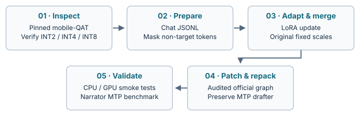

# Forge-E4B-p

**Fixed-scale LoRA adaptation of Gemma 4 E4B mobile QAT → mixed-bit LiteRT-LM with MTP**

A reproducible proof of concept for adapting Google's Gemma 4 E4B mobile-QAT checkpoint without discarding its original mixed INT2/INT4/INT8 representation or the official multi-token prediction (MTP) drafter.

[Workflow](#workflow) · [Validation](#validation) · [Benchmarks](#mtp-performance) · [Reproduce](#reproduce-it) · [Repository layout](#repository-layout)

---

| **3.49 GB** | **INT2 / INT4 / INT8** | **1.37×** | **1.66×** |
| :---: | :---: | :---: | :---: |
| Repacked model | Original mixed precision | RTX 4090 median MTP speedup | Pixel 10 Pro mean MTP speedup |

> **Scope:** A clean-checkout, one-update synthetic proof of concept. This demonstrates packaging correctness and CPU/GPU inference, not model quality or generalization.

## Workflow

The adaptation retains the original quantization grid. Only audited packed weight payloads in the official LiteRT-LM graph are patched; package metadata and the MTP drafter are preserved.

The workflow supports exact source-weight round-tripping, masked chat preparation, fixed-scale LoRA merging, audited graph patching and inference validation without converting the source checkpoint to uniform precision.

## Validation

The [clean reproduction record](repro/results/POC_REPRODUCTION_20261124.md) documents a run from a fresh checkout on November 24, 2026.

| Check | Observed result |
| :--- | :--- |
| Source round-trip | Bit-exact across all 613 packed weight tensors |
| Synthetic LoRA update | One optimizer update; finite loss and nonzero adapter gradients |
| Fixed-scale merge | 127 INT4 values changed in one tensor; INT2 and INT8 unchanged |
| Graph patch | Packed merge hashes match; bytes outside target payloads unchanged |
| LiteRT-LM package | 20 sections, 3,492,003,840 bytes; original config, tokenizer and MTP drafter retained |
| Functional inference | CPU and RTX 4090 GPU smoke tests generated the expected response |

## MTP performance

| Backend | Package | Statistic | N per mode | MTP off (tok/s) | MTP on (tok/s) | Speedup | TTFT off (s) | TTFT on (s) |
| :--- | :--- | :--- | ---: | ---: | ---: | ---: | ---: | ---: |
| PC CPU | Official stock | Median | 3 | 13.73 (12.88–13.86) | 17.45 (17.16–17.46) | **1.27×** (+27.1%) | 2.16 (2.14–2.67) | 2.01 (2.00–2.16) |
| PC CPU | LoRA POC | Median | 3 | 14.59 (14.56–14.70) | 18.90 (18.63–18.96) | **1.30×** (+29.6%) | 2.105 (2.068–2.476) | 1.973 (1.964–2.108) |
| RTX 4090 | Official stock | Median | 3 | 111.45 (108.41–111.58) | 154.48 (100.92–154.91) | **1.39×** (+38.6%) | 0.12 (0.12–0.84) | 0.12 (0.12–1.47) |
| RTX 4090 | LoRA POC | Median | 3 | 110.91 (107.54–111.53) | 151.62 (110.74–153.91) | **1.37×** (+36.7%) | 0.120 (0.120–0.765) | 0.119 (0.117–1.205) |
| Pixel 10 Pro GPU | LoRA POC | Mean* | 4 | 7.7 (7.5–7.8) | 12.8 (12.7–13.0) | **1.66×** (+66.2%) | 2.85 (2.52–3.03) | 2.77 (2.42–2.98) |

Values are **median (min–max)** of valid generations for the PC configurations. *Pixel values are mean (min–max): individual run measurements are not included in the reproduction record, so exact medians cannot be reported. N is the number of generations per MTP mode (32 generations total across all configurations). Speedup is the ratio of the reported central statistics; the ranges are observed extrema, not confidence intervals.

**Benchmark protocol.** All runs used the registered Forge-GM `benchmark.narrator` v1 fixture, a 4,096-token context, 500-token output ceiling and disabled thinking; every generation passed the 200-token validity floor. TTFT denotes time to first token.

- **PC:** LiteRT-LM 0.19.2, CPU (XNNPACK for the stock baseline) and RTX 4090 (WebGPU/Dawn over Direct3D 12), three runs per package/backend/MTP mode. The explicit sampler used top-k 64, top-p 0.95 and temperature 1.0. Cold-start samples remain included in the medians. Stock drafter success was 41.9% on CPU and 47.6% on GPU; POC drafter success was 47.6% and 46.4%, respectively.
- **Pixel:** Android 17, Forge GM 1.0-v116, LiteRT-LM 0.19.1 / LiteRT 2.3.2, GPU with model-default precision and sampler, four valid serial runs per mode. The transferred POC package was verified by SHA-256 and the app reported MTP effective off/on as configured. Mean generation time decreased from 59.88 s (59.08–61.49) to 37.09 s (36.26–37.74), a **38.1% reduction**, with 440 → 441 output tokens. Total time excludes engine/model initialization.

These are separate within-configuration MTP comparisons. PC results use medians and Pixel results use means; the differing runtimes and samplers preclude a controlled cross-device comparison. Output lengths vary with natural generation endings. No Pixel CPU or stock Pixel results are reported, and these measurements do not establish model quality.

**Full evidence:** [LoRA POC PC](repro/results/POC_REPRODUCTION_20261124.md#app-aligned-narrator-benchmark) · [Official stock PC](repro/results/POC_REPRODUCTION_20261124.md#stock-official-e4b-pc-baseline) · [Pixel GPU](repro/results/POC_REPRODUCTION_20261124.md#pixel-10-pro-gpu-mtp-benchmark) · [Pixel engine and metric collection](docs/MOBILE_QAT_LORA_TO_MIXED_BIT_LITERT_LM.md#6b-pixel-10-pro-gpu-mtp-benchmark). The records retain package hashes, per-run values or available ranges, and exact settings.

## Reproduce it

**Start here:** [Clean proof-of-concept reproduction instructions](docs/MOBILE_QAT_LORA_TO_MIXED_BIT_LITERT_LM.md#clean-proof-of-concept-reproduction-repository-tracked-inputs)

The implementation guide also documents the original experiment, quantization invariants, pinned source and stock bundle revisions, label masking, training protocol, GPU requirements and patch/repack steps. Use the clean-reproduction section for repository-tracked inputs rather than the historical workstation-specific paths.

| Environment | Tested configuration |
| :--- | :--- |
| Training | Python 3.11, pinned PyTorch / Transformers stack |
| Export and inference | Separate pinned environment, LiteRT-LM and builder 0.19.2 |
| Host | Windows, NVIDIA RTX 4090; inference via CPU or WebGPU/Dawn over Direct3D 12 |
| Inputs | Pinned mobile-QAT checkpoint and stock LiteRT-LM bundle; external downloads |

### Repository layout

| Path | Purpose |
| :--- | :--- |
| [`docs/MOBILE_QAT_LORA_TO_MIXED_BIT_LITERT_LM.md`](docs/MOBILE_QAT_LORA_TO_MIXED_BIT_LITERT_LM.md) | Implementation guide and clean-checkout instructions |
| [`repro/scripts/`](repro/scripts/) | Download, inspect, prepare, train, merge, patch, package and benchmark |
| [`repro/fixtures/`](repro/fixtures/) | Synthetic chat sample, provenance mapping and exact narrator prompt |
| [`repro/requirements-training.lock`](repro/requirements-training.lock) | Pinned training dependencies |
| [`repro/requirements-export.lock`](repro/requirements-export.lock) | Pinned export dependencies |
| [`repro/results/`](repro/results/) | Reproduction evidence, hashes, audits and benchmark results |

Model downloads and environments are intentionally excluded from Git. The tracked training fixture is synthetic; use an access-controlled corpus for private data and follow the guide's split and masking requirements.

---

Upstream references: [Gemma mobile-QAT checkpoint (pinned revision)](https://huggingface.co/google/gemma-4-E4B-it-qat-mobile-transformers/tree/8e3ac78f1a4a97c19f5f194ab362a2206f71d961) · [Stock LiteRT-LM bundle (pinned revision)](https://huggingface.co/litert-community/gemma-4-E4B-it-litert-lm/tree/f254b5ba6e36f7d89cc7892e268e9877bc20f0a0) · [LiteRT-LM](https://github.com/google-ai-edge/LiteRT-LM)
