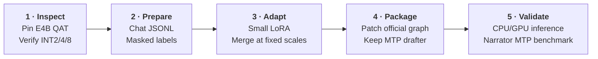

# Forge-E4B-p

A reproducible proof-of-concept for adapting Google’s Gemma 4 E4B mobile-QAT checkpoint with a small LoRA update, then packaging the resulting weights as a LiteRT-LM model while retaining the official MTP drafter.

The workflow preserves the checkpoint’s mixed INT2/INT4/INT8 weight representation and fixed quantization scales. It patches only verified packed weight payloads in the official LiteRT-LM graph, keeps the original package metadata and MTP drafter, and checks the built model on CPU and GPU. The included short synthetic run demonstrates that the procedure works end to end; it is a packaging and inference proof, not a model-quality evaluation.

## What this repo is useful for

- Reproducing a small LoRA-to-LiteRT-LM packaging run from the pinned mobile-QAT checkpoint.
- Inspecting and round-tripping the original packed INT2/INT4/INT8 weights before training.
- Merging LoRA changes back onto original fixed scales without converting the checkpoint to uniform precision.
- Verifying that only intended graph payloads changed and that the official MTP drafter remains in the package.
- Comparing MTP off/on TTFT and decode throughput on the Forge-GM long-form narrator workload.

## Workflow

### From pinned QAT checkpoint to tested LiteRT-LM package

Starting from the pinned QAT checkpoint, the workflow verifies its packed weights, prepares masked chat examples, and applies a small LoRA update. It then patches only audited LiteRT-LM weights, keeps the official MTP drafter, and checks CPU/GPU inference and benchmark performance.

## Demonstrated result

A clean-checkout, one-update synthetic POC produced a 3.49 GB LiteRT-LM package. Its source QAT checkpoint passed an exact packed-weight round-trip; the fixed-scale merge changed 127 INT4 values, with no INT2 or INT8 changes. The official MTP drafter remained present. CPU and RTX 4090 GPU smoke checks generated a response.

On the Forge-GM `benchmark.narrator` workload (4096 context, 500-token output ceiling, three runs per mode), MTP increased median decode throughput on both tested PC backends:

| PC backend | MTP off | MTP on | Median speedup | Median TTFT off → on |
|---|---:|---:|---:|---:|
| CPU | 14.59 tok/s | 18.90 tok/s | **1.30×** (+29.6%) | 2.105 s → 1.973 s |
| RTX 4090 / WebGPU-D3D12 | 110.91 tok/s | 151.62 tok/s | **1.37×** (+36.7%) | 0.120 s → 0.119 s |

All measured generations passed the benchmark’s 200-token validity floor. The first run in each mode included cold-start effects; full per-run measurements and settings are in the [reproduction record](repro/results/POC_REPRODUCTION_20261124.md). These numbers validate MTP behavior for this package and workload; they are not a broad model-quality claim or a cross-device comparison.

## Reproduce it

Start with the [implementation guide](docs/MOBILE_QAT_LORA_TO_MIXED_BIT_LITERT_LM.md). It covers the pinned model and stock bundle revisions, dependencies, scripts, fixtures, label masking, LoRA protocol, quantization checks, patch/repack steps, GPU requirements, and benchmark procedure.

The executable repro kit lives in [`repro/`](repro/):

- [`scripts/`](repro/scripts/) — download, inspect, prepare, train, merge, patch, package, and benchmark tools.
- [`fixtures/`](repro/fixtures/) — synthetic chat sample, provenance mapping, and exact narrator prompt.
- [`requirements-training.lock`](repro/requirements-training.lock) and [`requirements-export.lock`](repro/requirements-export.lock) — separate pinned environments.
- [`results/POC_REPRODUCTION_20261124.md`](repro/results/POC_REPRODUCTION_20261124.md) — hashes, audits, benchmark metrics, and obstacles fixed during a fresh reproduction.

The model downloads and environments are intentionally kept out of Git. The training fixture is synthetic; use an access-controlled corpus for private data and follow the guide’s split and masking requirements.
